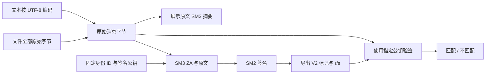

<div align="center">

# SM2 / SM3 Signature Lab

**签名绑定的是哪些字节？验签通过又能证明什么？**

数字签名与篡改验证 · 个人课程项目 · AI 辅助开发  
Python · Tkinter / ttkbootstrap · gmssl · OpenSSL 交叉验证

[验证证据](docs/VALIDATION.md) · [V2 与旧版迁移](docs/MIGRATION.md) · [来源记录](docs/SOURCE_HISTORY.md)

[](https://github.com/zongemory-spec/sm2-sm3-signature-system/actions/workflows/tests.yml)
[](LICENSE)

</div>

---

## 背景与目标

数字签名演示不能只证明“自己签、自己验能通过”。摘要编码、身份 ID、原始文件字节和公钥来源，都会影响签名含义与互操作结果。

本项目从文本与文件签名课程作品出发，补齐明确的消息字节规则、输入校验、旧版兼容入口和独立验证证据。目标是让签名、验签与篡改拒绝可解释、可复现，不将教学程序包装成生产密码产品。

**这里提供摘要与数字签名，不对文件内容加密。**

## 从原文到验签



文本保留空格与换行；文件不提取文字，不忽略格式或元数据。更改任何字节都应使原签名不再匹配。原文 SM3 摘要用于展示，V2 不再将其十六进制文本当作原文签名。

## 关键实现与取舍

| 问题 | 当前实现 | 边界 |
| --- | --- | --- |
| 新旧签名含义不同 | 新导出带 SM2SM3-V2: 标记，旧签名需显式兼容 | 不自动降级，不重写旧产物 |
| 文件格式变化被提取文字掩盖 | V2 签完整文件字节 | 不是 PDF 可视化签章或办公软件签名协议 |
| 密钥、签名格式错误 | 校验私钥范围、公钥曲线点、密钥匹配与 r/s 范围 | 不等同密码库审计或侧信道防护 |
| 临时签名随机数 | 使用 secrets 生成有效范围内 nonce，失败时有限重试 | 不对所依赖纯 Python 实现宣称常数时间 |
| 错误公钥测试误把异常当成功 | 使用另一个有效公钥实际验签 | 格式错误与有效但不匹配的密钥分开处理 |
| 私钥被界面直接展示 | 不显示私钥，覆盖旧密钥前确认 | 本地仍为明文文件，Windows ACL 未提供专门保护 |
| 本地闭环不证明兼容 | 增加 OpenSSL 双向验签与身份 ID 负例 | 只验证所声明的固定参数组合 |

V2 固定身份 ID 为 `1234567812345678`，使用 gmssl 3.2.2 的消息签名接口。导出是应用层版本标记加固定宽度 r||s 十六进制，OpenSSL 测试侧转换为 DER；两者不能未经转换直接互换。

## 本地运行

Python 3.12 与可用的 Tk 桌面环境：

```powershell
python -m venv .venv
.\.venv\Scripts\python.exe -m pip install -r requirements.txt
.\.venv\Scripts\python.exe main.py
```

macOS / Linux 将解释器路径替换为 `.venv/bin/python`；Linux 可能需要发行版的 Tk 软件包。使用一次性演示密钥，不导入真实生产私钥。

1. 生成演示密钥，输入文本或选择文件，点击对应签名按钮。
2. 导出带 V2 标记的签名文件。
3. 验签页导入对应公钥与签名，验证完全相同的文本或文件。
4. 运行篡改临时副本、错误公钥测试，查看日志中的拒绝结果。

界面验证步骤见 [VALIDATION](docs/VALIDATION.md)。更新前保留旧公钥、签名与资料；不需要为了升级重建密钥。旧签名按 [MIGRATION](docs/MIGRATION.md) 选择兼容模式。

## 已验证结果

本次本地运行日期：**2026-10-31**。

| 验证 | 结果 |
| --- | --- |
| unittest 回归 | 17 项通过，0 跳过、0 失败 |
| SM3 已知向量 | abc 与 abcd×16 匹配公开结果 |
| SM3 独立实现对照 | 与 hashlib / OpenSSL 对二进制、UTF-8 等输入结果一致 |
| gmssl 签名 → OpenSSL 验证 | 通过 |
| OpenSSL 签名 → gmssl 验证 | 通过 |
| 修改消息 / 修改身份 ID | OpenSSL 均拒绝原签名 |
| 空白变化、文件字节变化、有效错误公钥 | 回归测试拒绝 |

[JSON 报告](reports/verification.json) · [测试日志](reports/tests.txt) · [检查范围与出处](docs/VALIDATION.md)

```sh
python -m unittest discover -s tests -v
python demo_evidence.py --require-openssl --out reports/my-verification.json
```

脚本仅生成临时演示密钥，报告不导出私钥或 nonce。输出文件须不存在。找不到 OpenSSL 时不会伪造互操作成功；CI 强制要求该项。

**桌面自动化连接本次超时，未完成按钮级自动验收或截图；这不计入上面的通过结果。**

## 代码阅读入口

| 文件 | 关注点 |
| --- | --- |
| `crypto/sm2_manager.py` | V2 消息签名、旧版 API 与输入校验 |
| `crypto/sm3_manager.py` | UTF-8 文本和完整字节摘要 |
| `gui/sign_page.py`、`gui/verify_page.py` | 签名、版本选择、错误公钥与篡改演示 |
| `utils/key_manager.py` | 本地演示密钥保存与加载 |
| `tools/openssl_check.py` | 内存内 OpenSSL 双向互操作探针 |
| `tests/`、`demo_evidence.py` | 正负例、证据与复现 |

## 已知限制

- 不是经认证或独立审计的密码产品；测试不构成完整标准符合性证明。
- 不提供证书链、公钥身份认证、可信时间戳、文件加密或不可抵赖的业务流程。
- 私钥保存在本机明文文件；POSIX 环境尝试限制私钥文件权限，不等同加密存储、HSM 或 Windows ACL 管理。
- 两个密钥文件不是原子成对存储，仍需自行备份；加载会拒绝不匹配的密钥。
- 文件整体读入内存；大文件性能与侧信道风险未作为本轮验证目标。
- 固定签名 ID 和格式只用于所声明的实验，不承诺直接兼容所有 SM2/TLS/DNSSEC/办公签章产品。

后续优先验证更多公开向量和文件案例，再考虑标准化加密私钥容器；不自行发明私钥加密格式。

## 来源与许可

个人课程项目，AI 辅助开发。[来源记录](docs/SOURCE_HISTORY.md) 保留历史背景，[旧说明](README.legacy.md) 仅供旧版查阅。[参考资料](docs/VALIDATION.md#核对来源) 链接到公开算法说明、库接口及 OpenSSL 文档。

代码采用 [MIT License](LICENSE)。不要将 keys/、logs/、个人原文件或真实签名材料提交到公开仓库。
